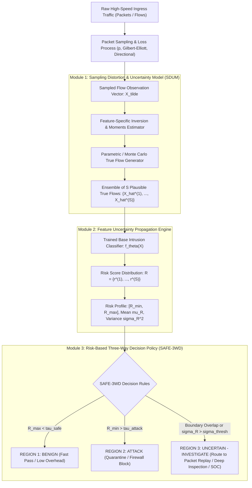

# FlowGuard: Sampling-Aware Network Intrusion Detection

[](https://www.python.org/downloads/release/python-3119/)
[](#core-architecture--technical-novelty)
[](#project-overview)
[](LICENSE)

**FlowGuard** is an open-source, reproducible research framework for **Sampling-Aware Network Intrusion Detection (NIDS)** under incomplete traffic, packet decimation, and switch buffer packet loss. 

Instead of naively treating incomplete network-flow features as complete or relying on rigid point-estimate classifiers, FlowGuard explicitly quantifies **sampling-induced feature uncertainty** and applies a **Risk-Based Three-Way Decision Policy (SAFE-3WD)** to safely triage ambiguous traffic.

---

## Table of Contents
- [1. Research Motivation & Problem Statement](#1-research-motivation--problem-statement)
- [2. Core Architecture & Technical Novelty](#2-core-architecture--technical-novelty)
- [3. End-to-End System Workflow](#3-end-to-end-system-workflow)
- [4. Implementation Roadmap](#4-implementation-roadmap)
- [5. Repository Structure](#5-repository-structure)
- [6. Installation & Quickstart](#6-installation--quickstart)
- [7. Benchmark Datasets & Comparative Baselines](#7-benchmark-datasets--comparative-baselines)
- [8. Documentation & Project Assets](#8-documentation--project-assets)
- [9. Citation & Contact](#9-citation--contact)

---

## 1. Research Motivation & Problem Statement

Modern enterprise and backbone networks operate at 100 Gbps+ line rates. Inspecting every packet in real time is computationally prohibitive, forcing routers and switches to deploy:
- **Packet Sampling:** $1$-in-$N$ random or systematic sampling (e.g., sFlow, NetFlow, IPFIX).
- **Buffer Exhaustion Drops:** Stochastic burst loss under congestion (modeled via Gilbert-Elliott Markov chains).
- **Asymmetric Routing:** Forward and backward flow paths sampled at disparate rates.

### The Failure of Conventional ML-NIDS
State-of-the-art intrusion classifiers (Random Forests, LightGBM, Deep Neural Networks) are trained on pristine, complete traffic traces (e.g., CIC-IDS2017, CSE-CIC-IDS2018). When deployed on sampled network traffic, they suffer from two critical flaws:
1. **Feature Distortion Masquerade:** Attack volumes shrink proportionally to sampling rates, while non-linear features (inter-arrival time variance, SYN/ACK ratios) degrade unpredictably, causing true intrusions to resemble harmless background traffic.
2. **Overconfident Point Estimates:** Traditional models emit single probability scores $P(\text{Attack} \mid \tilde{X})$, completely unaware of the observational variance introduced by sampling. This leads to **catastrophic False Negative spikes** (up to 40%+ missed attacks under 1:100 sampling).

---

## 2. Core Architecture & Technical Novelty

FlowGuard bridges this gap through three mathematically grounded innovations:

```
                      FlowGuard Novelty Architecture
 ┌────────────────────────────────────────────────────────────────────────┐
 │ 1. Sampling Distortion & Uncertainty Model (SDUM)                      │
 │    Inverts the sampling process using Negative Binomial and Gamma      │
 │    posterior distributions to reconstruct S plausible true flows.     │
 └───────────────────────────────────┬────────────────────────────────────┘
                                     │
                                     ▼
 ┌────────────────────────────────────────────────────────────────────────┐
 │ 2. Feature Uncertainty Propagation Engine                              │
 │    Passes the ensemble of plausible flows through the base classifier  │
 │    to obtain an attack-risk interval: [R_min, R_max], mean, variance.  │
 └───────────────────────────────────┬────────────────────────────────────┘
                                     │
                                     ▼
 ┌────────────────────────────────────────────────────────────────────────┐
 │ 3. Risk-Based Three-Way Decision Policy (SAFE-3WD)                     │
 │    • Region 1 (Benign):      R_max < tau_safe    -> Fast Pass         │
 │    • Region 2 (Attack):      R_min > tau_attack  -> Immediate Block   │
 │    • Region 3 (Investigate): Interval overlaps   -> Deep Inspection   │
 └────────────────────────────────────────────────────────────────────────┘
```

1. **Sampling Distortion & Uncertainty Model (SDUM):**
   - For an observed sampled flow vector $\tilde{X}$ under sampling rate $p$, SDUM draws $S$ independent plausible true flow realizations $\hat{X}^{(s)} \sim \mathcal{P}(X \mid \tilde{X}, p, \Sigma)$, preserving empirical feature correlations.
2. **Uncertainty Propagation Engine:**
   - Evaluates each realization $r^{(s)} = f_\theta(\hat{X}^{(s)})$ to construct a rigorous risk profile:
     $$R_{\min} = \min_{s} r^{(s)}, \quad R_{\max} = \max_{s} r^{(s)}, \quad \mu_R = \mathbb{E}[R], \quad \sigma_R^2 = \operatorname{Var}[R]$$
3. **Risk-Based Three-Way Decision Policy (SAFE-3WD):**
   - Eliminates overconfident guesses on distorted traffic by deferring ambiguous flows to a dedicated investigation pathway, keeping selective accuracy high on accepted decisions.

---

## 3. End-to-End System Workflow



---

## 4. Implementation Roadmap

FlowGuard is structured into six sequential phases defined in [plan_to_implement/02_PROJECT_ROADMAP_AND_PHASES.md](plan_to_implement/02_PROJECT_ROADMAP_AND_PHASES.md):

- [x] **Phase 1: Environment Setup & Scaffolding:** Virtual environment, package tree, and smoke test suite.
- [ ] **Phase 2: Dataset Pipeline & Preprocessing:** Data hygiene, feature grouping, and 65% Train / 15% Calibration / 20% Test stratified split.
- [ ] **Phase 3: Base Classifier & Oblivious Baseline:** LightGBM / Random Forest training on pristine flows; quantifying detection collapse on sampled traffic.
- [ ] **Phase 4: SDUM & Plausible True Flow Sampler:** Negative Binomial / Gamma moment inversion and vectorized Monte Carlo risk propagation ($S=30$).
- [ ] **Phase 5: SAFE-3WD Policy Calibration:** Cost-sensitive threshold optimization ($\tau_{\text{safe}}, \tau_{\text{attack}}$) on the calibration split.
- [ ] **Phase 6: Comparative Benchmarks & Publication Artifacts:** Comprehensive comparison against all 4 baseline paradigms and LaTeX table generation.

---

## 5. Repository Structure

```
FlowGuard/
├── flowguard/                         # Core Python package
│   ├── __init__.py                    # Top-level exports and version
│   ├── data/                          # Data ingestion, cleaning & loaders
│   ├── sampling/                      # Random, periodic & Gilbert-Elliott loss models
│   ├── uncertainty/                   # SDUM and Monte Carlo flow generators
│   ├── decision/                      # SAFE-3WD policy engine and calibrators
│   ├── models/                        # Base classifiers (LightGBM, RF, MLP) & baselines
│   └── evaluation/                    # Metrics (DR, FPR, FNR, ECE, Coverage) & visualizers
│
├── configs/                           # Active experiment YAML configurations
│   └── default_config.yaml            # Master experiment hyperparameters
│
├── plan_to_implement/                 # Comprehensive engineering blueprint
│   ├── 01_ARCHITECTURE_AND_SPECS.md   # Mathematical formulas & formal algorithms
│   ├── 02_PROJECT_ROADMAP_AND_PHASES.md # Step-by-step milestone timeline
│   ├── 03_DATASET_AND_FEATURE_PIPELINE.md # Feature dictionary & cleaning rules
│   ├── 04_BASELINE_COMPARISONS_AND_METRICS.md # Baseline specs & LaTeX tables
│   ├── 05_PROJECT_STRUCTURE_AND_CODE_SKELETON.md # Class interfaces & code templates
│   ├── config_template.yaml           # Reference config template
│   ├── requirements.txt               # Dependencies list
│   └── README.md                      # Blueprint index & guide
│
├── experiments/                       # Executable benchmark scripts
├── tests/                             # Pytest test suite
│   ├── __init__.py
│   └── test_smoke.py                  # Smoke test for package integrity
│
├── FlowGuard_Faculty_Presentation.pptx # 10-slide academic faculty slide deck
├── FlowGuard_Project_and_Slides_Explanation.pdf # 9-page layman guide with analogies & defense Q&A
├── .gitignore                         # Strict exclusion rules (paper collection protected)
└── README.md                          # Repository documentation (this file)
```

---

## 6. Installation & Quickstart

### Prerequisites
- Windows 10/11, Linux, or macOS
- Python 3.11+ recommended

### Setup Environment
```bash
# Clone the repository
git clone https://github.com/Shobhit-20-04/FlowGuard.git
cd FlowGuard

# Activate virtual environment
# Windows:
.\.venv\Scripts\Activate.ps1
# Linux/macOS:
source .venv/bin/activate

# Install core dependencies
pip install -r plan_to_implement/requirements.txt
```

### Run Smoke Test Suite
```bash
pytest tests/ -v
```

---

## 7. Benchmark Datasets & Comparative Baselines

### Evaluated Benchmark Datasets
- **CIC-IDS2017:** Canadian Institute for Cybersecurity multi-day intrusion dataset.
- **CSE-CIC-IDS2018:** Large-scale enterprise network attack dataset hosted on AWS.
- **NF-UQ-NIDS:** Standardized NetFlow v9 intrusion detection dataset.

### Comparative Baseline Paradigms
1. **B1: Oblivious Model:** Standard NIDS trained on complete data, evaluated on raw sampled traffic.
2. **B2: Feature Imputation:** Missing-value scaling and MICE / Autoencoder reconstruction ($\hat{X} = \tilde{X}/p$).
3. **B3: Sampling-Augmented Training:** Multi-condition retraining with synthetic multi-rate sampled traffic.
4. **B4: Deep Uncertainty:** Traditional MC-Dropout / Deep Ensemble uncertainty without physical sampling models.
5. **Proposed: FlowGuard (SAFE-3WD):** Sampling-aware feature uncertainty estimation coupled with calibrated three-way decisions.

---

## 8. Documentation & Project Assets

The repository includes presentation materials designed for academic evaluation and thesis defense:
- **Faculty Presentation:** [FlowGuard_Faculty_Presentation.pptx](FlowGuard_Faculty_Presentation.pptx) — A light-themed, widescreen 10-slide academic deck detailing the research gaps, mathematical formulations, and SAFE-3WD novelty with comprehensive speaker notes.
- **Project & Slide Explanation Guide:** [FlowGuard_Project_and_Slides_Explanation.pdf](FlowGuard_Project_and_Slides_Explanation.pdf) — A 9-page guide explaining the system using real-life analogies (Airport security, medical triage) alongside faculty defense Q&A.

> **Note on Research Literature:**  
> The internal literature review collection comprising 82 full-text peer-reviewed papers and tracking sheets is maintained in a local directory (`paper/`) and is strictly excluded from version control under `.gitignore` in compliance with academic publisher copyright agreements.

---

## 9. Citation & Contact

If you use FlowGuard in your research or find this framework useful, please cite this project:

```bibtex
@misc{flowguard2026,
  title={FlowGuard: Sampling-Aware Network Intrusion Detection with Feature Uncertainty and Risk-Based Three-Way Decisions},
  author={FlowGuard Research Team},
  year={2026},
  howpublished={\url{https://github.com/Shobhit-20-04/FlowGuard}}
}
```

**Project Maintainer:** Solo M.Tech Research Project  
**Repository:** [https://github.com/Shobhit-20-04/FlowGuard](https://github.com/Shobhit-20-04/FlowGuard)
