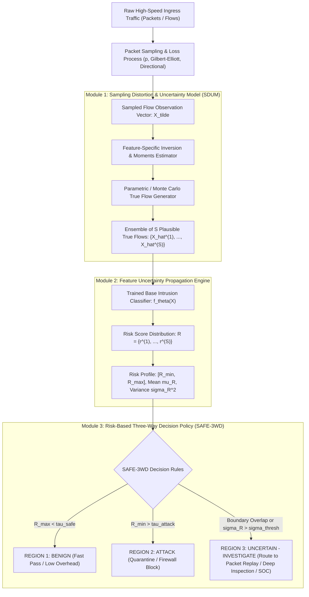

# FlowGuard: Technical Architecture & System Specifications

## 1. Executive Problem Formulation

Standard ML-based Network Intrusion Detection Systems (NIDS) assume complete, pristine flow feature vectors $X \in \mathbb{R}^d$ (e.g., total packets, byte volumes, duration, flow inter-arrival times, flag ratios). However, in high-throughput enterprise networks and ISP backbones, line-rate capture is computationally prohibitive. Traffic is observed through:
1. **Packet Sampling:** $1$-in-$N$ random or systematic packet decimation (sFlow, NetFlow).
2. **Channel Impairments:** Stochastic burst packet drop due to switch buffer exhaustion (Gilbert-Elliott packet loss).
3. **Asymmetric / Directional Capture:** Asymmetric routing causing forward and backward flow legs to be sampled at heterogeneous rates.

When an uncorrected model $f_\theta$ processes a sampled/degraded flow $\tilde{X}$, two catastrophic failure modes occur:
- **Severe Distortion of Non-Linear Features:** Heavy-tailed metrics (e.g., standard deviation of packet lengths, flow inter-arrival time variance, SYN/ACK ratios) degrade unpredictably, causing true attacks to masquerade as benign traffic.
- **Overconfident Misclassification:** Standard classifiers generate crisp point-estimate probabilities $P(Y=1 \mid \tilde{X})$, completely oblivious to the epistemic and observational variance introduced by sampling.

**FlowGuard** resolves this fundamental gap by replacing point-estimate inference with a **Sampling-Aware Feature Uncertainty & Risk-Based Three-Way Decision Framework (SAFE-3WD)**.

---

## 2. End-to-End System Architecture



---

## 3. Mathematical Formulations

### 3.1 Sampling Distortion Models

Let $N$ be the true packet count of a flow, and $k$ be the observed packet count under uniform packet sampling with rate $p \in (0, 1]$.
The probability of observing $k$ packets follows a Binomial distribution:
$$k \sim \operatorname{Binomial}(N, p)$$

Given an observed count $k$, the posterior distribution of the unobserved true count $N$ (assuming a flat or negative binomial prior) follows a Negative Binomial distribution:
$$\mathbb{E}[N \mid k, p] = \frac{k}{p}, \quad \operatorname{Var}(N \mid k, p) = \frac{k(1 - p)}{p^2}$$

For flow volume $V = \sum_{i=1}^N L_i$, where $L_i$ are packet lengths:
$$\mathbb{E}[V \mid \tilde{V}, p] = \frac{\tilde{V}}{p}, \quad \operatorname{Var}(V \mid \tilde{V}, p) \approx \frac{\tilde{V}}{p^2} \cdot \left( \mu_L + \frac{\sigma_L^2}{\mu_L} (1 - p) \right)$$

For temporal intervals (Flow Inter-Arrival Times, IAT):
If true IATs follow an exponential distribution with rate $\lambda$, then under independent sampling with probability $p$, the observed sampled interval $\tilde{\tau}$ is the sum of a geometrically distributed number of true intervals:
$$\tilde{\tau} = \sum_{j=1}^M \tau_j, \quad M \sim \operatorname{Geometric}(p)$$
$$\mathbb{E}[\tilde{\tau}] = \frac{1}{p \lambda}, \quad \operatorname{Var}(\tilde{\tau}) = \frac{2 - p}{p^2 \lambda^2}$$

### 3.2 Plausible Flow Reconstruction (Monte Carlo Draws)
Rather than a naive single-point mean imputation $\hat{X} = \tilde{X}/p$, FlowGuard draws $S$ independent, correlated realizations:
$$\hat{X}^{(s)} \sim \mathcal{P}(X \mid \tilde{X}, p, \Sigma), \quad s \in \{1, 2, \dots, S\}$$
where $\Sigma$ encodes the empirical correlation structure between packet count, byte volume, and duration.

### 3.3 Risk Propagation & Statistical Bounds
Each realization is evaluated by the trained base classifier $f_\theta$:
$$r^{(s)} = f_\theta(\hat{X}^{(s)}) \in [0, 1], \quad s \in \{1, \dots, S\}$$

The risk profile of the flow is defined by:
$$R_{\min} = \min_{s} r^{(s)}, \quad R_{\max} = \max_{s} r^{(s)}$$
$$\mu_R = \frac{1}{S} \sum_{s=1}^S r^{(s)}, \quad \sigma_R^2 = \frac{1}{S-1} \sum_{s=1}^S (r^{(s)} - \mu_R)^2$$

### 3.4 SAFE-3WD Decision Rule
Given calibrated decision boundaries $\tau_{\text{safe}}$ and $\tau_{\text{attack}}$ with $0 < \tau_{\text{safe}} \le \tau_{\text{attack}} < 1$:

$$\mathcal{D}(\tilde{X}) = \begin{cases}
\textbf{Benign} (\text{Fast Accept}), & \text{if } R_{\max} < \tau_{\text{safe}} \text{ and } \sigma_R^2 \le \sigma_{\text{thresh}}^2 \\
\textbf{Attack} (\text{Immediate Block}), & \text{if } R_{\min} > \tau_{\text{attack}} \text{ and } \sigma_R^2 \le \sigma_{\text{thresh}}^2 \\
\textbf{Investigate} (\text{Defer / Deep Inspection}), & \text{otherwise (interval intersects boundary or } \sigma_R^2 > \sigma_{\text{thresh}}^2 \text{)}
\end{cases}$$

---

## 4. Formal Algorithms

### Algorithm 1: Sampling Distortion & Uncertainty Model (SDUM)
```
Input: Sampled flow vector X_tilde, Sampling rate p, Sampling mode M, Monte Carlo sample size S
Output: Set of S plausible true flow representations {X_hat^(1), ..., X_hat^(S)}

1: Initialize ensemble list E = []
2: Parse feature sub-vectors:
     k_fwd, k_bwd <- Observed packet counts
     v_fwd, v_bwd <- Observed byte volumes
     t_dur        <- Observed flow duration
     stats_iat    <- Inter-arrival time statistics
3: If M == 'random_sampling':
4:     Compute count posterior parameters: r = k, prob = p
5:     For s = 1 to S do:
6:         N_hat_fwd ~ NegBinomial(k_fwd, p)
7:         N_hat_bwd ~ NegBinomial(k_bwd, p)
8:         V_hat_fwd ~ Gamma(shape=k_fwd, scale=v_fwd / (k_fwd * p))
9:         V_hat_bwd ~ Gamma(shape=k_bwd, scale=v_bwd / (k_bwd * p))
10:        IAT_hat   <- Reconstructed IAT distribution moments(stats_iat, p)
11:        X_hat^(s) <- Assemble reconstructed vector(N_hat, V_hat, t_dur, IAT_hat)
12:        Append X_hat^(s) to E
13:    End For
14: Else if M == 'burst_loss':
15:    Apply Gilbert-Elliott inverted loss factor to correct transition probabilities
16: Return E
```

### Algorithm 2: SAFE-3WD Decision Policy
```
Input: Plausible flow set E = {X_hat^(1), ..., X_hat^(S)}, Classifier f_theta, Thresholds tau_safe, tau_attack, sigma_thresh
Output: Decision D in {BENIGN, ATTACK, INVESTIGATE}, Confidence Metrics

1: Initialize risk array R = zeros(S)
2: For s = 1 to S do:
3:     R[s] <- f_theta(E[s])
4: End For
5: Compute R_min <- min(R), R_max <- max(R)
6: Compute mu_R <- mean(R), sigma_sq <- var(R)
7:
8: If R_max < tau_safe and sigma_sq <= sigma_thresh:
9:     D <- "BENIGN"
10: Else if R_min > tau_attack and sigma_sq <= sigma_thresh:
11:    D <- "ATTACK"
12: Else:
13:    D <- "INVESTIGATE"
14:
15: Return D, (R_min, R_max, mu_R, sigma_sq)
```
